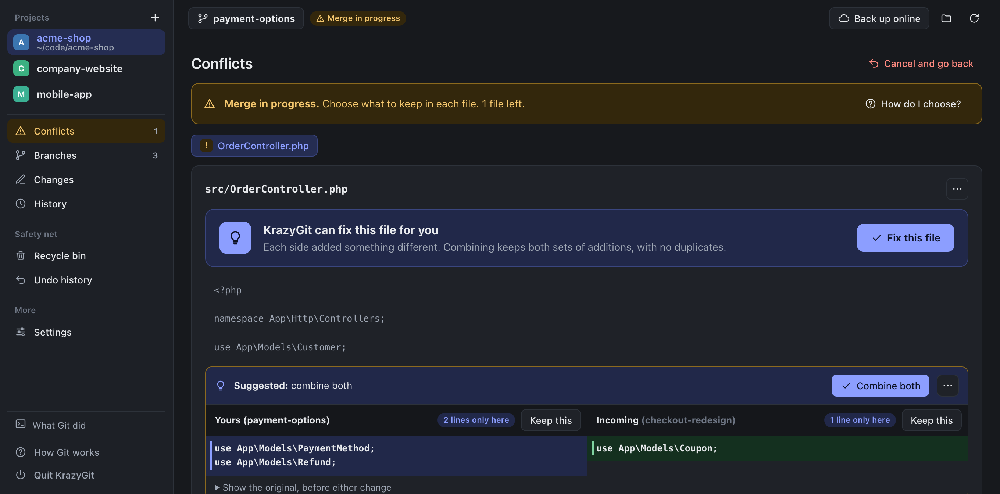

# KrazyGit

**Git without the commands.** A friendly Mac app for managing the Git projects on your computer: branches, commits, syncing and conflicts, in plain English, with an undo button for almost everything.



## What it does

- **Tells you what to do next.** A single "next step" card: commit your changes, sync with GitHub, tidy up merged branches, finish a merge.
- **One Sync button** downloads new commits and uploads yours. No pull, push or fetch to remember.
- **Branches made easy:** separate views for branches on your computer and online, search, tick several and act on them at once, current branch always on top.
- **Conflicts it can actually help with.** It compares both sides (and the original), suggests the choice that loses nothing, and can fix whole files in one click. When both sides changed the same line, it says so and leaves the decision to you.
- **Side-by-side diffs** with line numbers, or inline if you prefer.
- **Hard to break.**
  - Most actions show an **Undo** button.
  - Deleted branches, tags and stashes go to a **Recycle bin**.
  - Discarded work is **backed up**.
  - **Undo history** can rewind a branch to any earlier moment.
  - It also warns before you commit passwords or huge files.
- **Safe defaults for teams.** `master`/`main` only download when a project has a team server and your own copy, and new branches are published where your other branches already go.
- **Learn as you go.** "What Git did" shows the exact commands it ran.

## Install

You need **macOS**, **Git** and **Python 3.8 or newer**. Both come with Apple's free Command Line Tools: if they're missing, run `xcode-select --install` in Terminal. Google Chrome is optional; with it, KrazyGit opens in its own app window.

**Download:** grab the latest zip from [Releases](https://github.com/heybee72/krazygit/releases), unzip it anywhere, and double-click **KrazyGit.app**.

- **The first time,** macOS may say the app is from an unidentified developer, because it isn't signed with a paid Apple certificate. Right-click the app, choose **Open**, then **Open** again.
- **When macOS asks** whether KrazyGit can access a folder such as Documents, choose **Allow**. That's where your projects are.
- **To keep it handy,** drag KrazyGit.app to your Dock. Keep it next to `krazygit.py` rather than moving it on its own.

**From source:**

```sh
git clone https://github.com/heybee72/krazygit.git
cd krazygit
./build-app.sh        # builds KrazyGit.app, or skip it and run: python3 krazygit.py
```

KrazyGit quits by itself about ten minutes after you close its window, or use **Quit KrazyGit** in the sidebar.

## Privacy and safety

- **It never leaves your computer.** It runs only on your machine, at `127.0.0.1`, and only the window it opened can talk to it.
- **It doesn't send anything anywhere.** No accounts, no tracking, no analytics. The only network traffic is Git's own sync with the servers your projects already use.
- **Sign-ins go through your Git setup.** Your normal Git credentials are used (on a Mac, the Keychain). When a server needs a password, a standard macOS dialog asks for it.
- **Your files stay readable by other tools.** Its own data is plain Git: deleted items are parked under `refs/krazygit-trash/` (empty the Recycle bin to remove them), and your project list is in `~/.krazygit.json`.

Linux and Windows: `python3 krazygit.py` works and opens in your browser, but the folder picker and sign-in dialogs are Mac-only for now.

## Contributing

Contributions are very welcome, especially from people who find Git confusing: that's who this is for.

**How it's built.** There's no build step and there are no dependencies, on purpose:

| File | What's in it |
|---|---|
| `krazygit.py` | A small local web server; every Git action is one function marked `@op`. Python standard library only. |
| `krazygit.html` | The whole interface: plain HTML, CSS and JavaScript, no frameworks. |
| `build-app.sh` | Builds the Mac launcher, `KrazyGit.app`. |
| `test_krazygit.py` | Runs every Git action against throwaway repositories. |
| `test_suggestions.js` | Checks the conflict suggestions. |

**Run it while you work on it:** `python3 krazygit.py`, then reload the window after editing `krazygit.html`. Restart the server after editing `krazygit.py`. To run a second copy beside your everyday one, use `KRAZYGIT_PORT=7421 python3 krazygit.py`.

**Before you open a pull request:**

```sh
python3 test_krazygit.py && node test_suggestions.js
```

The same checks run automatically on every pull request.

**House rules:**

- **No new dependencies.** If the standard library or the browser can do it, use that.
- **Plain English in the interface.** Name things by what people want ("Sync", "Undo this commit"), not Git jargon, and keep it short.
- **Nothing should lose work.** Anything destructive needs a backup, the Recycle bin, or an Undo, and a test that proves it.
- **Keep changes small and focused,** and add a check to the test file for new behaviour.

Found a bug or have an idea? [Open an issue](https://github.com/heybee72/krazygit/issues) and include what you clicked and what you expected.

## Licence

[MIT](LICENSE) © 2026 Abraham Bossey
